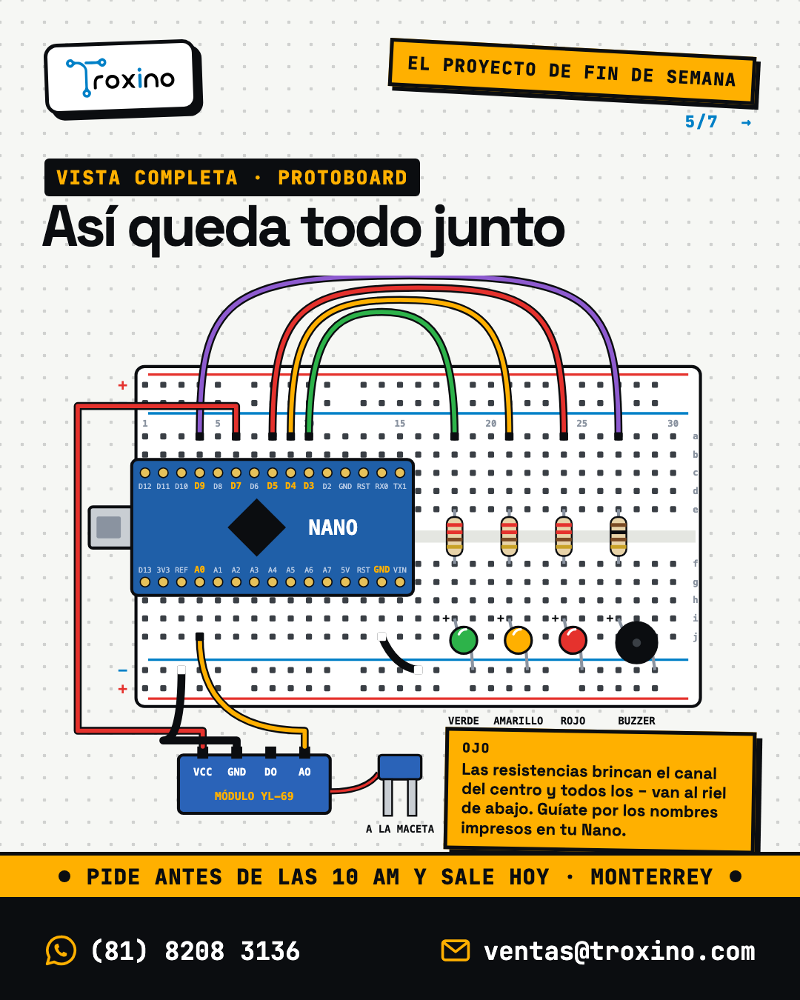

# La planta que avisa cuando tiene sed

**El proyecto de fin de semana · miércoles 4 de noviembre de 2026**

Un sensor clavado en la maceta mide qué tan húmeda está la tierra. Tres LEDs te dicen cómo va (verde: bien, amarillo: pronto, rojo: tiene sed) y, cuando la tierra se seca, un buzzer hace un pitido para que no se te olvide regarla.

## Para qué sirve en la escuela

- **Feria de ciencias:** junta biología y electrónica, y da datos medibles. Riega, anota la lectura cada hora en el Monitor Serie y grafica cómo se seca la tierra (o compara macetas con tierra, arena y composta).
- **Prepa y secundaria:** práctica de entradas analógicas (`analogRead`), salidas digitales y condicionales `if / else`.
- **Ingeniería:** introducción a sensores resistivos, calibración y por qué conviene alimentar un sensor solo cuando se lee (corrosión).

**Nivel:** principiante · **Tiempo:** 2 a 3 horas · **Sin soldar** (Nano con pines soldados en protoboard y cables DuPont).

## Materiales

Verificados en el catálogo el 2 de noviembre de 2026.

| Cant. | Pieza | SKU | Enlace |
|---|---|---|---|
| 1 | Tarjeta de desarrollo Nano R3, mini USB, pines soldados | MCU-038 | https://troxino.com/producto/tarjeta-de-desarrollo-nano-r3-generico-tipo-miniusb-pines-soldados-compatible-con-arduino |
| 1 | Cable USB A a mini B (si ya tienes uno mini USB, úsalo) | PRO-289 | https://troxino.com/producto/manhattan-cable-usb-a-macho-usb-mini-b-macho-18-metros-negro |
| 1 | Protoboard de 400 puntos | PRO-268 | https://troxino.com/producto/protoboard-breadboard-400-puntos-blanca |
| 1 | Sensor de humedad de suelo YL-69 (horquilla + módulo) | SEN-038 | https://troxino.com/producto/sensor-de-humedad-de-tierra-o-suelo-yl-69 |
| 1 | Buzzer pasivo de 12 mm | CMP-461 | https://troxino.com/producto/buzzer-pasivo-de-12mm-33-5v-30mah |
| 1 | LED verde 5 mm difuso | PAN-092 | https://troxino.com/producto/led-verde-5mm-difuso-28-32v-20ma |
| 1 | LED amarillo 5 mm difuso | PAN-061 | https://troxino.com/producto/led-amarillo-5mm-difuso-18-22v-20ma |
| 1 | LED rojo 5 mm difuso | PAN-056 | https://troxino.com/producto/led-rojo-5mm-difuso-18-22v-20ma |
| 3 | Resistencia de 220 Ω 1/4 W (para los LEDs) | CMP-781 | https://troxino.com/producto/220-ohms-resistencia-de-14-watts |
| 1 | Resistencia de 100 Ω 1/4 W (para el buzzer) | CMP-764 | https://troxino.com/producto/100-ohms-resistencia-de-14-watts |
| 1 | Cables DuPont macho-macho, 40 pzs, 10 cm | PRO-236 | https://troxino.com/producto/cables-dupont-jumper-macho-macho-40pzs-10cm |
| 1 | Cables DuPont macho-hembra, 40 pzs, 20 cm (del módulo a la protoboard) | PRO-180 | https://troxino.com/producto/cables-dupont-jumper-macho-hembra-40pzs-20cm |

**De tu casa:** una planta en maceta (o un vaso con tierra), un vaso con agua para probar, una laptop con el IDE de Arduino.

## Conexiones

El Nano va a lo largo de la protoboard, montado sobre el canal central (una fila de pines de cada lado). Usa el riel azul (−) de abajo como tierra común. Las resistencias brincan el canal central y los LEDs y el buzzer quedan del otro lado, con su pata − en el riel.

| Pieza | Pin de la pieza | A dónde va |
|---|---|---|
| Nano | GND | Riel − de la protoboard |
| Módulo YL-69 | VCC | Nano **D7** (lo prendemos solo al medir) |
| Módulo YL-69 | GND | Riel − |
| Módulo YL-69 | AO | Nano **A0** |
| Módulo YL-69 | DO | Sin conectar |
| Horquilla YL-69 | 2 pines | Los 2 pines del módulo, con el cablecito que trae el sensor |
| LED verde | Pata larga (+) | Resistencia de 220 Ω → Nano **D3** |
| LED amarillo | Pata larga (+) | Resistencia de 220 Ω → Nano **D4** |
| LED rojo | Pata larga (+) | Resistencia de 220 Ω → Nano **D5** |
| Los 3 LEDs | Pata corta (−) | Riel − |
| Buzzer pasivo | + (pata marcada o más larga) | Resistencia de 100 Ω → Nano **D9** |
| Buzzer pasivo | − | Riel − |

Corrientes: los LEDs rojo y amarillo quedan en unos 13 mA y el verde en unos 9 mA; el buzzer, con su resistencia de 100 Ω, por debajo de 20 mA. Todo dentro de lo que aguanta un pin del Nano.

## Paso a paso

1. **Monta el Nano** sobre el canal central de la protoboard, con el conector USB hacia afuera. Presiona parejo hasta que entren todos los pines.
2. **Tierra común:** con un cable macho-macho, une el pin GND del Nano al riel − de la protoboard.
3. **Los tres LEDs:** colócalos del lado libre de la protoboard. Pata corta al riel −, pata larga a una fila con su resistencia de 220 Ω, y de la resistencia un cable a D3 (verde), D4 (amarillo) y D5 (rojo).
4. **El buzzer:** pata − al riel −; pata + a una resistencia de 100 Ω y de ahí un cable a D9.
5. **El sensor:** conecta la horquilla al módulo con su cablecito. Del módulo a la protoboard usa cables macho-hembra de 20 cm: VCC a D7, GND al riel − y AO a A0. DO se queda libre.
6. **Sube el código:** conecta el Nano por USB, en el IDE elige *Arduino Nano* y el puerto. Si no sube, cambia el procesador a *ATmega328P (Old Bootloader)*.
7. **Calibra:** abre el Monitor Serie a 9600. Anota la lectura con la horquilla al aire (seca, cerca de 1000) y metida en un vaso con agua (cerca de 300 a 400). Ajusta `UMBRAL_PRONTO` y `UMBRAL_SED` con tu tierra: seca vs. recién regada.
8. **A la maceta:** clava la horquilla en la tierra hasta la mitad, sin mojar el módulo ni los cables. Listo: la planta ya te avisa.

## Código

Está en [`planta-con-sed/planta-con-sed.ino`](planta-con-sed/planta-con-sed.ino). Descarga la carpeta y ábrela en el IDE de Arduino.

## Cómo probarlo

1. Al conectar el Nano, los tres LEDs se prenden uno tras otro y suena un pitido: el cableado de LEDs y buzzer está bien.
2. Con la horquilla al aire debe quedar en **rojo** y pitar.
3. Métela en un vaso con agua: pasa a **verde** en un par de segundos.
4. Sácala y sécala con un trapo: vuelve a rojo. Con la mano húmeda tocando las dos patas debería quedar en amarillo o verde.

## Problemas comunes

- **Siempre en rojo, aun en agua:** revisa que VCC del módulo vaya a D7 (no a 5V suelto ni a nada) y AO a A0, no DO.
- **Siempre en verde:** quizá conectaste DO en lugar de AO, o los umbrales no van con tu tierra. Mira los números en el Monitor Serie y ajusta.
- **No sube el código:** elige *ATmega328P (Old Bootloader)* y, si la computadora no ve el puerto, instala el driver CH340.
- **Un LED no prende:** está al revés (la pata larga va hacia la resistencia) o su resistencia no comparte fila con él.
- **El buzzer no suena o suena muy bajito:** que sea el **pasivo** (el código usa `tone`), con su pata + hacia D9.
- **La horquilla se pone verde o negra con las semanas:** es corrosión normal de este tipo de sensor; por eso solo la prendemos al leer. Para algo que dure meses, usa el sensor resistente a la corrosión.

## Para mejorarlo

- **Riego automático:** agrega un relevador y una mini bomba de agua para que riegue sola cuando llegue a rojo.
- **Gráfica para la feria:** usa el *Serial Plotter* del IDE para ver cómo se seca la tierra a lo largo del día.
- **Modo noche:** agrega una fotorresistencia para que el pitido no suene cuando está oscuro.
