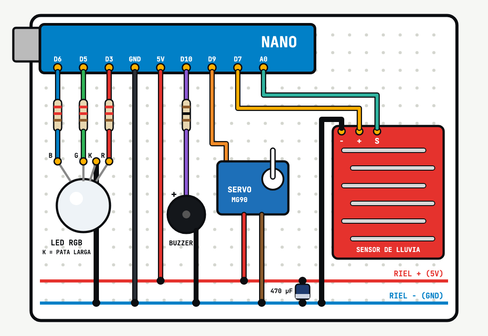

# El detector de lluvia

El proyecto de fin de semana de Troxino.com, 11 de noviembre de 2026.

Caen gotas en el sensor: suena una melodía de "¡mete la ropa!", un LED RGB se pone azul y un servo cierra un techo de cartón sobre un tendedero. Con un aguacero el LED parpadea en morado y suena otra alarma. Cuando lleva 10 segundos seco, el LED vuelve a verde y el techo se abre. El Monitor Serie (9600) muestra la lectura del sensor: 0 seco, más alta con más agua.

## Materiales

- Arduino Nano (o compatible)
- Protoboard de 400 puntos
- Sensor de lluvia / nivel de agua T1592 (pines S, +, −)
- Micro servomotor MG90
- LED RGB 5 mm de cátodo común
- 3 resistencias de 220 Ω
- 1 resistencia de 100 Ω
- Buzzer pasivo de 12 mm
- Capacitor electrolítico de 470 µF 16 V
- Cables DuPont macho-macho y macho-hembra

De tu casa: cartón, cinta, hilo y pinzas para el tendedero, y un atomizador con agua para probar.

## Conexiones

| Pieza | Nano |
|---|---|
| Sensor S | A0 |
| Sensor + (se prende solo al medir) | D7 |
| Sensor − | GND |
| LED RGB: R vía 220 Ω | D3 |
| LED RGB: G vía 220 Ω | D5 |
| LED RGB: B vía 220 Ω | D6 |
| LED RGB: cátodo (pata más larga) | GND |
| Servo naranja (señal) | D9 |
| Servo rojo / café | 5V / GND |
| Buzzer + vía 100 Ω (− a GND) | D10 |
| Capacitor 470 µF: + / franja (−) | 5V / GND, junto al servo |

## Código

[`detector-de-lluvia/detector-de-lluvia.ino`](detector-de-lluvia/detector-de-lluvia.ino). Usa la librería `Servo`, que ya viene con el IDE. En el IDE elige *Arduino Nano*; si no sube, procesador *ATmega328P (Old Bootloader)*.

## Calibra tu sensor

Abre el Monitor Serie y anota la lectura seco, con unas gotas y muy mojado. Ajusta `UMBRAL_LLUVIA` y `UMBRAL_AGUACERO` en el código. Si el techo queda al revés, intercambia `TECHO_ABIERTO` y `TECHO_CERRADO`.

¿Dudas? Mándanos WhatsApp al (81) 8208 3136 o escríbenos a ventas@troxino.com. Todo el material en [troxino.com](https://troxino.com).
