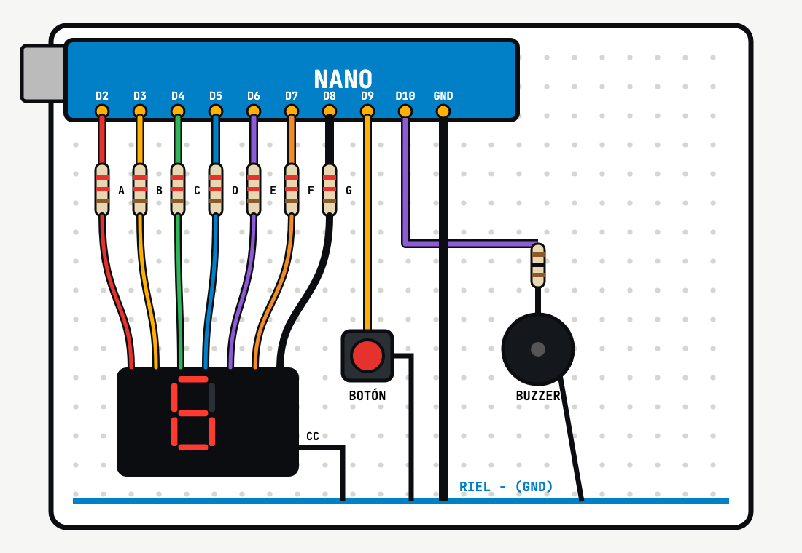

# El dado electrónico

El proyecto de fin de semana de Troxino.com, 18 de noviembre de 2026.

Aprietas el botón, el display de 7 segmentos gira por números al azar, cada vez más lento, y se queda en un resultado del 1 al 6 con un pitido. Cada tirada se cuenta y se manda al Monitor Serie (9600) para comprobar si tu dado es justo.

## Materiales

- Arduino Nano (o compatible)
- Protoboard de 400 puntos
- Display de 7 segmentos cátodo común 5161AS
- 7 resistencias de 220 Ω
- 1 resistencia de 100 Ω
- Botón de 4 pines
- Buzzer pasivo de 12 mm
- Cables DuPont macho-macho

## Conexiones

| Pieza | Nano |
|---|---|
| Segmento A (pin 7) vía 220 Ω | D2 |
| Segmento B (pin 6) vía 220 Ω | D3 |
| Segmento C (pin 4) vía 220 Ω | D4 |
| Segmento D (pin 2) vía 220 Ω | D5 |
| Segmento E (pin 1) vía 220 Ω | D6 |
| Segmento F (pin 9) vía 220 Ω | D7 |
| Segmento G (pin 10) vía 220 Ω | D8 |
| Botón (el otro lado a GND) | D9 |
| Buzzer + vía 100 Ω (− a GND) | D10 |
| CC del display (pin 3 u 8) | GND |

A0 queda sin conectar a propósito: su ruido da una semilla distinta al azar.

## Código

[`dado-electronico/dado-electronico.ino`](dado-electronico/dado-electronico.ino). En el IDE elige *Arduino Nano*; si no sube, procesador *ATmega328P (Old Bootloader)*.

## Pon a prueba tu dado

Tira 60 veces y anota cuántas salió cada número: deberían rondar 10 cada uno. Con más tiradas se parecen más.

¿Dudas? Mándanos WhatsApp al (81) 8208 3136 o escríbenos a ventas@troxino.com. Todo el material en [troxino.com](https://troxino.com).
